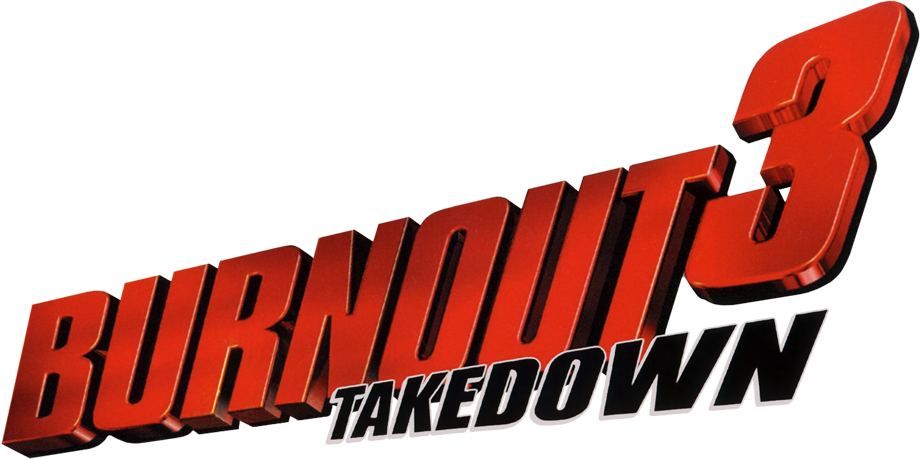

<p align="center">
  
</p>

<h1 align="center">Symbols and documentation</h1>

<p align="center">
  <b>The code of Burnout 3: Takedown (PS2), mapped out.</b><br>
  Link maps, symbols, class layouts and a wiki of the game's systems, from the prototype discs.
</p>

<p align="center">
  <a href="https://u0rhs.github.io/burnout3-symbols/"><b>Website</b></a> ·
  <a href="docs/files.md"><b>Symbols and maps</b></a> ·
  <a href="#contents"><b>Contents</b></a> ·
  <a href="docs/systems/README.md">Game systems</a> ·
  <a href="docs/classes/README.md">Classes</a> ·
  <a href="docs/reference/retail-function-names.md">Retail game</a> ·
  <a href="docs/reference/README.md">Reference</a> ·
  <a href="https://github.com/u0rhs/burnout3-symbols/archive/refs/heads/main.zip">Download ZIP</a>
</p>

Everything the Burnout 3 prototype discs ([Burnout 3, 8 June 2004](https://hiddenpalace.org/Burnout_3:_Takedown_(Jun_8,_2004_prototype))
and [Burnout 2, 29 July 2002](https://hiddenpalace.org/Burnout_2:_Point_of_Impact_(Jul_29,_2002_prototype)), both
preserved by Hidden Palace) reveal about the game's code, turned into readable data and
documentation, with Burnout 2's debug information where it helps explain Burnout 3. For anyone working on
a Burnout 3 remaster, decompilation, remake, mod or patch.

> Text only: no game code, executables, modules or assets (no `.elf`, `.irx` or `.bin` files, no byte
> dumps, no audio or textures). The repository holds symbol tables, link maps, debug information rewritten
> as C declarations, strings, file listings, decoded tables, Python tools and Markdown.

## Get the files

The most-used files, one click away. **All of them, with sizes: [Symbols and maps](docs/files.md).**

| File | What it is |
|---|---|
| [`DNAT_200.symbols.csv`](data/burnout3-prototype/maps/DNAT_200.symbols.csv) | Every symbol of the Burnout 3 prototype (17,819), demangled, with address, size, section and source file |
| [`classes.txt`](data/burnout3-prototype/maps/classes.txt) | All 890 Burnout 3 classes and their methods, with addresses in four builds |
| [`B3O0PCH.symbols.csv`](data/burnout3-prototype/maps/B3O0PCH.symbols.csv) | The unoptimised build's symbols: 11,020 functions, including the small inline ones |
| [`DNAT_200.MAP`](data/burnout3-prototype/originals/DNAT_200.MAP) | The original text link map of the prototype executable |
| [`function-names.csv`](data/burnout3-retail/function-names.csv) | 1,146 named functions in the retail game (SLUS-21050), 863 verified |
| [`memory-map.csv`](data/burnout3-retail/memory-map.csv) | Named addresses in the retail game (SLUS-21050): save data, race state, tuning, display, controls |
| [`types.h`](data/burnout2-prototype/SLUS_204.97/types.h) | 969 Burnout 2 types with member offsets: the ancestors of many Burnout 3 classes |
| [`functions.csv`](data/burnout2-prototype/SLUS_204.97/functions.csv) | 2,309 Burnout 2 functions with parameter names, source files and lines |
| [`b3-functions-by-build.csv`](docs/reference/data/b3-functions-by-build.csv) | Every Burnout 3 function's address and size in each of the four prototype builds |

## Highlights

- **A page for every class.** 890 Burnout 3 classes, each with its methods in four builds, its vtable,
  static data, and the layout of its Burnout 2 ancestor. Example: [`CB3VehiclePhysics`](docs/classes/CB3VehiclePhysics.md).
- **The game by system.** Physics, AI, traffic, crashes, cameras, HUD, menus, audio, rendering, network,
  progression: every source file and class, sorted ([game systems](docs/systems/README.md)).
- **The retail game, named.** 1,146 functions in the shipping executable named, 863 verified
  ([retail function names](docs/reference/retail-function-names.md)), plus every address Nahelam's mods
  touch: a hidden development menu, debug views, a car viewer ([Nahelam's mods](docs/reference/nahelam-mods.md)).
- **The retail game, located.** About 150 addresses in the shipping executable: the save profile, boost,
  the 1/60 s simulation step, the game's own widescreen flag, every HUD layout value, the button mapping
  ([retail memory map](docs/reference/retail-memory-map.md)).
- **Burnout 2's source structure.** Criterion's original file tree, with every function's parameters,
  locals and line numbers ([source outlines](data/burnout2-prototype/SLUS_204.97/source_outline/README.md)).
- **How it draws.** The 22 VU microcode programs behind the cars, world, glass, water, sky and effects
  ([renderer overview](docs/renderer-overview.md)).
- **Formats documented from scratch.** CodeWarrior's DWARF 1, its binary link maps and its name
  mangling ([formats](docs/formats/README.md)), with Python tools that read them ([tools](docs/tools.md)).

## Contents

Every part of the documentation, in the same groups as the website's sidebar.

<!-- contents:start -->
- **[Symbols and maps](docs/files.md)**
- **[Getting started](docs/README.md)**
  [Builds](docs/builds.md) · [Finding things](docs/data-guide.md) · [Glossary](docs/glossary.md)
- **[Game systems](docs/systems/README.md)**
  [AI drivers](docs/systems/ai.md) · [Audio and music](docs/systems/audio.md) · [Cameras and replays](docs/systems/cameras-replay.md) · [Core, memory, input and platform](docs/systems/core-platform.md) · [Crashes, takedowns and scoring](docs/systems/crash-scoring.md) · [Demo-disc code](docs/systems/demo-builds.md) · [Effects](docs/systems/effects.md) · [Frontend and menus](docs/systems/frontend.md) · [Game flow, modes and race logic](docs/systems/game-flow.md) · [HUD](docs/systems/hud.md) · [Libraries linked into Burnout 3](docs/systems/libraries.md) · [Network and online](docs/systems/network-online.md) · [Progression, profiles and saves](docs/systems/progression-saves.md) · [Rendering](docs/systems/rendering.md) · [Tracks, world and streaming](docs/systems/tracks-streaming.md) · [Traffic](docs/systems/traffic.md) · [2D graphics and UI toolkit](docs/systems/ui-2d.md) · [Vehicles, physics and collision](docs/systems/vehicles-physics.md)
- **[Classes](docs/classes/README.md)**
- **[Renderer overview](docs/renderer-overview.md)**
- **[Retail game](docs/reference/retail-function-names.md)**
  [Retail function names (SLUS-21050)](docs/reference/retail-function-names.md) · [Retail memory map (from cheat codes and patches)](docs/reference/retail-memory-map.md) · [Nahelam's Burnout 3 mods and research](docs/reference/nahelam-mods.md) · [Disc contents](docs/discs.md)
- **[Reference: Burnout 3](docs/reference/README.md)**
  [Assert expressions](docs/reference/asserts.md) · [Burnout 3 global data](docs/reference/b3-globals.md) · [Burnout 3 prototype builds compared](docs/reference/build-comparison.md) · [Debug and development features](docs/reference/debug-features.md) · [File hashes](docs/reference/hashes.md) · [IOP modules with symbols](docs/reference/iop-modules.md) · [Memory layout](docs/reference/memory-layout.md) · [Code that was written but not linked](docs/reference/unlinked-code.md) · [The value database (VDB.XML)](docs/reference/value-database.md) · [VU microcode programs](docs/reference/vu-programs.md)
- **[Reference: Burnout 2 lineage](docs/reference/class-ancestors.md)**
  [Burnout 3 classes and their Burnout 2 ancestors](docs/reference/class-ancestors.md) · [Burnout 2 → Burnout 3 class lineage](docs/reference/class-lineage.md) · [Burnout 2 → Burnout 3 function lineage](docs/reference/function-lineage.md) · [Burnout 2 → Burnout 3 source files](docs/reference/source-file-lineage.md) · [Burnout 2 classes and structs](docs/reference/b2-classes.md) · [Class hierarchy (Burnout 2)](docs/reference/class-hierarchy.md) · [Enums (Burnout 2)](docs/reference/enums.md) · [RenderWare and library functions](docs/reference/renderware-api.md)
- **[Uses](docs/avenues/README.md)**
  [Using this data for a decompilation](docs/avenues/decompilation.md) · [Using this data for a remake](docs/avenues/remake.md) · [Using this data for a remaster](docs/avenues/remaster.md)
- **[Formats](docs/formats/README.md)**
  [CodeWarrior C++ name mangling](docs/formats/codewarrior-demangling.md) · [CodeWarrior PS2 DWARF 1](docs/formats/codewarrior-dwarf1.md) · [CodeWarrior link maps and assert files](docs/formats/codewarrior-maps.md)
- **[Data and tools](data/README.md)**
  [Burnout 3 prototype data](data/burnout3-prototype/README.md) · [Burnout 3 retail data](data/burnout3-retail/README.md) · [Burnout 2 prototype data](data/burnout2-prototype/README.md) · [Burnout 2 source outlines](data/burnout2-prototype/SLUS_204.97/source_outline/README.md) · [Reference tables (CSV)](docs/reference/data/README.md) · [Tools](docs/tools.md)
- **[Project](docs/related-projects.md)**
  [Related resources](docs/related-projects.md) · [Open questions](docs/open-questions.md) · [Changelog](docs/changelog.md) · [GitHub repository](https://github.com/u0rhs/burnout3-symbols)
<!-- contents:end -->

## In numbers

| | |
|---|---|
| Burnout 3 prototype | 4 link maps (one text, three binary) · 8,301 functions in the DNAT_200 build, 11,020 in the unoptimised build · 890 classes · 312 vtables · 595 game source files · 3,383 named variables · 22 VU microcode programs · 2,243 assert expressions · 3,056 unlinked symbols |
| Burnout 3 retail | 1,146 named functions (863 verified) · 1,480 addresses from Nahelam's mods · 775 files listed · 2,255 strings with addresses · 7,525 tuning values (1,949 changed since the prototype) · about 150 named memory addresses, 67 vehicle IDs, 139 event medal bytes |
| Burnout 2 prototype | 12,023 symbols · 2,309 functions with full debug info · 969 types · 168 enums · 288 source files · 76,449 line entries |
| Burnout 2 → 3 | 62 class ancestors · 704 function counterparts · 25 source-file counterparts |
| Compiler, all three executables | Metrowerks CodeWarrior for PS2, MW MIPS C Compiler 2.4.1.01 |

## Layout

```
README.md          this page
docs/              the documentation (hand-written pages + generated systems/, classes/, reference/)
data/              the exported data, as text
tools/             the scripts that make data/ and the generated pages (tools/rebuild.sh)
assets/            logo and icons
```

Generated pages say so at the top; their **Notes** sections are kept when they are regenerated. Every
page starts with a `Home › Section` line. The pages are plain Markdown with relative links, so they work
on GitHub, in an editor, or as an Obsidian vault, and are also published as a searchable website with
GitHub Pages ([u0rhs.github.io/burnout3-symbols](https://u0rhs.github.io/burnout3-symbols/)), configured by
`_config.yml` and `_includes/`.

Burnout 3: Takedown is a trademark of Electronic Arts. This is an unofficial fan project.
